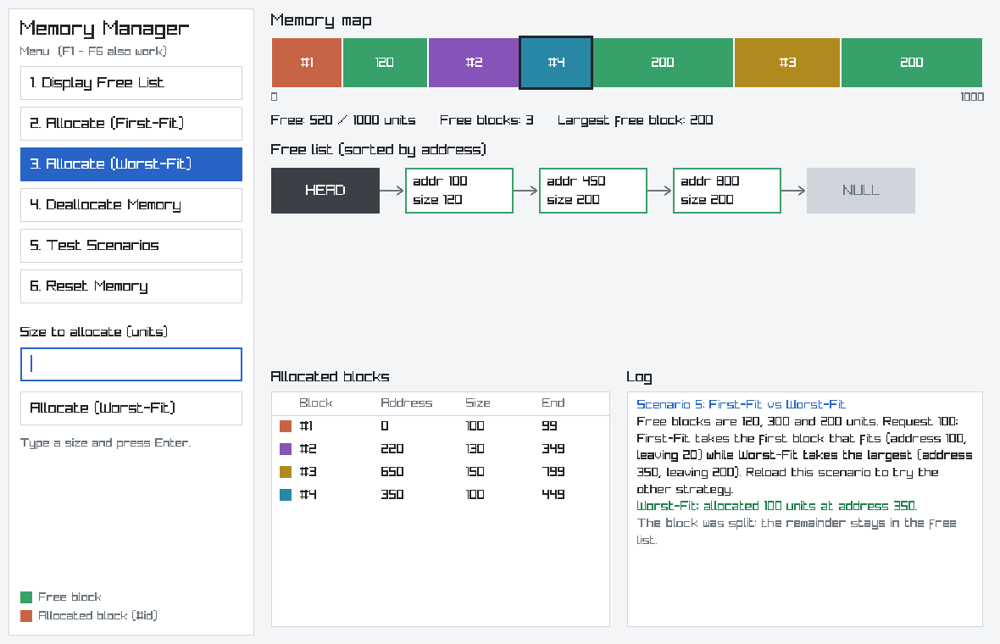

# Memory Management System

A menu-driven simulation of dynamic memory allocation, written in C with a [Raylib](https://www.raylib.com/) interface and built with CMake. It models a 1000-unit memory whose free space is tracked in a sorted, singly linked **free list**, and lets you allocate with **First-Fit** or **Worst-Fit**, deallocate with **coalescing**, and watch the free list change as you go.



## Features

- **Menu-driven GUI** with six options (mouse, or `F1` to `F6`):
  1. Display Free List
  2. Allocate Memory (First-Fit)
  3. Allocate Memory (Worst-Fit)
  4. Deallocate Memory
  5. Test Scenarios (five ready-made situations)
  6. Reset Memory
- **Memory map**: a bar showing free blocks (green) and allocated blocks (coloured, `#id`). Hover over it for exact address ranges. The block you just touched is outlined briefly.
- **Free list diagram**: `HEAD -> [addr, size] -> ... -> NULL`, redrawn after every operation.
- **Allocated blocks table**: click a row to fill in its address for deallocation.
- **Log** that explains what happened: exact fit vs split, which neighbours were coalesced, and why a request failed (empty list, not enough memory, or external fragmentation).
- **Unit tests** for the allocator logic, runnable without a window.

## Project structure

```
.
├── CMakeLists.txt
├── README.md
├── docs/screenshot.png
├── src/
│   ├── memory_manager.h    allocator API (no Raylib dependency)
│   ├── memory_manager.c    free list, First-Fit, Worst-Fit, Deallocate, scenarios
│   └── main.c              Raylib GUI
└── tests/
    └── test_memory.c       unit tests (CTest)
```

The allocator is deliberately separate from the GUI, so the algorithms can be tested and reasoned about on their own.

## Requirements

- A C99 compiler (GCC, Clang or MSVC)
- CMake 3.14 or newer
- Git and an internet connection on the first configure. If Raylib 5.0+ is not already installed, CMake downloads and builds Raylib 5.5 automatically.

**Linux** also needs the usual Raylib build dependencies:

```bash
# Debian / Ubuntu
sudo apt install build-essential git cmake libasound2-dev libx11-dev libxrandr-dev \
     libxi-dev libgl1-mesa-dev libglu1-mesa-dev libxcursor-dev libxinerama-dev \
     libwayland-dev libxkbcommon-dev
```

**macOS**: install the Xcode command line tools (`xcode-select --install`) and CMake (`brew install cmake`).

**Windows**: Visual Studio (with the "Desktop development with C++" workload) or MinGW-w64, plus CMake.

## Build and run

```bash
git clone <your-repo-url>
cd <your-repo>

cmake -S . -B build
cmake --build build

./build/memory_manager          # Windows (MSVC): build\Debug\memory_manager.exe
```

Useful CMake options:

| Option | Default | Effect |
|---|---|---|
| `-DBUILD_GUI=OFF` | `ON` | Skip Raylib and the GUI (core library and tests only) |
| `-DBUILD_TESTS=OFF` | `ON` | Skip the unit tests |
| `-DCMAKE_BUILD_TYPE=Release` | none | Optimised build (single-config generators) |

## Run the tests

```bash
cd build
ctest --output-on-failure
```

The tests need no graphics and cover all five recommended scenarios plus extra edge cases (coalescing on one side or both, double free, Worst-Fit ties, full allocation table, invalid input). Each test also calls `mm_validate()`, which checks that the free list is sorted and fully coalesced and that free plus allocated blocks cover memory exactly once.

## How to use the program

- **Allocate**: choose option 2 or 3, type a size, press `Enter` (or click the button). The result appears in the log and on the memory map.
- **Deallocate**: choose option 4, then type the **address** of an allocated block, or just click its row in the table.
- **Display Free List**: prints the list and a summary (block count, free units, largest block) to the log.
- **Reset**: restores memory to a single free block `[0, 1000]`.

## The algorithms

Each free block is a node `{ address, chunk_size, next }`, and the list is kept **sorted by address**.

**First-Fit** walks from the head and takes the first block that is large enough. An exact fit removes the node; a larger block is split by moving its start address forward and shrinking its size.

**Worst-Fit** scans the whole list and takes the **largest** block that fits (ties go to the earliest one), then splits or removes it the same way.

**Deallocate** inserts the freed block in address order, then merges it with the next block and/or the previous block if they touch. Keeping adjacent free blocks merged is what stops memory from fragmenting permanently.

All three run in O(n) time over the number of free blocks, and O(1) extra space.

### Implementation notes

- `first_fit` and `worst_fit` take a `Node **head`, because removing the first node changes the head pointer. `deallocate` returns the new head instead.
- Nodes that are removed or merged are `free()`d, so there are no leaks. The unit tests are clean under AddressSanitizer and UBSan.
- A real allocator would store the block size in a header. Here the program keeps a small **allocation table** instead, so deallocation only needs an address. This also lets the program reject double frees and addresses that were never allocated.

## Test scenarios (menu option 5)

Memory is 1000 units. Each scenario loads a specific state, and its instructions are printed in the log.

| # | Scenario | What to try | What you should see |
|---|---|---|---|
| 1 | Empty free list | Allocate any size (option 2 or 3) | Fails: the free list is empty. Deallocating address `0` brings back `[0, 1000]`. |
| 2 | Request too large | Allocate `200` | Fails even though 250 units are free: the largest block is 120 (external fragmentation). |
| 3 | Exact-fit request | First-Fit `100`, then `60` | Node removed from the middle of the list, then from the head. No split. |
| 4 | Dealloc and coalesce | Deallocate `100`, then `400`, then `800` | Free list goes `[0,100]->[300,100]->[600,200]` to `[0,400]->[600,200]` to `[0,800]` to `[0,1000]`. |
| 5 | First-Fit vs Worst-Fit | Allocate `100` with each (reload in between) | First-Fit uses address 100 (block of 120). Worst-Fit uses address 350 (block of 300). |

## Limitations

- Memory is a fixed 1000 units (`MEM_TOTAL` in `memory_manager.h`).
- At most 64 allocated blocks are tracked at once (`MAX_ALLOCS`). Allocating beyond that is reported in the log.
- The free list display shows the first 12 nodes and summarises the rest as `+k more`.

## Ideas for extending it

- Add **Best-Fit** (smallest block that fits) and **Next-Fit**, then compare fragmentation.
- Show an **external fragmentation** percentage.
- Add a **Compaction** menu option.
- Let the user choose the total memory size at start-up.

## Licence

Add your preferred licence here (for example MIT).